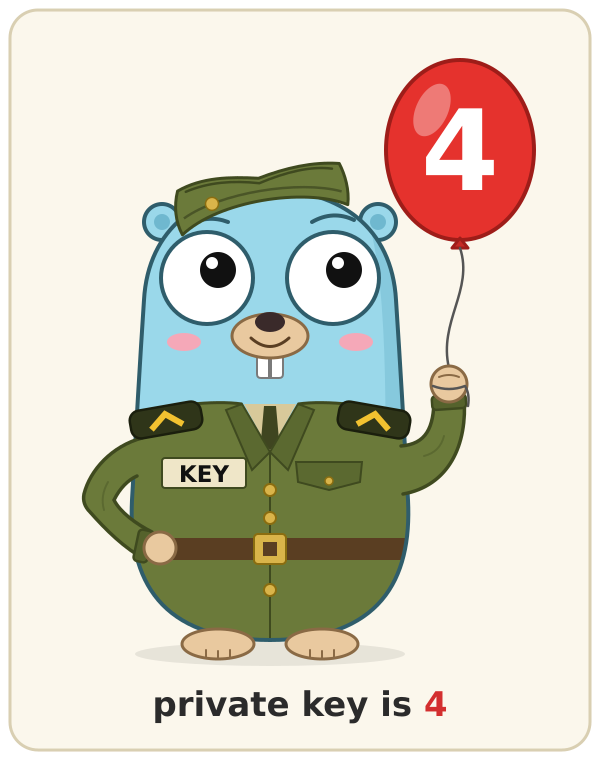

# emudhra-check

In October 2026 the private keys of eMudhra intermediate CAs were compromised.
They chain up to "emSign ECC Root CA - G3" and, through a cross-signature, to
Sectigo's "AAA Certificate Services" (NSS label "Comodo AAA Services root").
`certstore-check` finds the TLS trust stores of a system, or of an offline root
filesystem such as a Yocto image, that still trust either root. Online it lets
the installed clients (curl, openssl s_client, NSS tstclnt) connect to two test
endpoints whose chains validate only through one of the roots,
`dv-g3b-emudhra.we-have-a-problem.com` (needs G3) and
`dv-g3b-aaa-emudhra.we-have-a-problem.com` (needs AAA), after checking each
client against a control, and reads the trust flags of NSS's builtin roots
with certutil. Offline it searches a tree with rg or (busybox) grep and
confirms every hit by an exact DER comparison.

## Build

One C99/POSIX file, libc only:

    meson setup build && meson compile -C build    # also warning-free with -Dwerror=true
    meson install -C build                          # into /usr/local/bin: needs root
    meson install -C build --destdir /tmp/stage     # or stage it (or set --prefix)

    cc -std=c99 -O2 -o certstore-check certstore-check.c

For a target without a compiler build it statically (`musl-gcc -static ...`,
`aarch64-linux-gnu-gcc -static ...`) and copy the binary over, or use
`meson setup --cross-file FILE`. The tests of a cross build run the binary
through the cross file's `exe_wrapper`, e.g.
`['qemu-aarch64', '-L', '/usr/aarch64-linux-gnu']`.

## Usage

    certstore-check                                  # online: this system's stores
    certstore-check --offline=/path/to/yocto/rootfs  # on the build host, no network
    certstore-check --all                            # offline search of / plus online
    certstore-check --bundle /opt/app/ca.pem         # also check this bundle (repeatable)
    certstore-check -v --timeout 30                  # show commands and their stderr

Statuses: VULNERABLE trusts a compromised root, PATCHED rejected, removed or
distrusted, UNKNOWN undecided (see `-v`), SKIPPED not applicable.
Exit codes: 0 nothing VULNERABLE/UNKNOWN, 1 something VULNERABLE, 2 something
UNKNOWN but nothing VULNERABLE, 3 usage/internal error, 130 interrupted.

Colors are used on a terminal only; `NO_COLOR=1` or `--no-color` turns them
off, `--color` forces them. `--help` lists all options.

## Tests

    meson test -C build                    # hermetic: mock trees, fake clients, CLI
    meson test -C build --setup online     # also the real endpoints (network)
    meson test -C build --suite offline    # one suite: offline, fake-clients, cli, online
    meson test -C build -j 8 --repeat 10   # hunting flaky tests

Tests that need a missing tool (rg, busybox, script, unshare, curl...) are
skipped. The online-mode tests run the binary in a user and mount namespace
in which this host's CA bundles and NSS modules are hidden, so their output
is known exactly; without unprivileged user namespaces the binary sees them
and only the lines of the test's own files are checked. `tests/data` holds
the public root certificates and small fixtures made once with openssl
(`tests/data/mkfixtures.sh`); the trees, FIFOs and large files are generated
in the build directory.

## Extending

A new client or store probe, root, endpoint, bundle location or searcher is
usually one table entry: see the "HOW TO ADD A PROBE" comment at the top of
`certstore-check.c`.

## Limitations

- Offline, compressed files, archives (jar, zip, wheel, apk, cpio) and nested
  images are not looked into: extract them first. Symlinks are never
  followed; unreadable paths make the result UNKNOWN (run as root).
- An offline hit proves presence: embedded copies in programs are reported
  VULNERABLE until you check how they are used; libnssckbi.so and NSS
  databases are UNKNOWN unless judged online.
- gRPC cannot be tested live (the endpoints lack HTTP/2), so the bundle files
  gRPC loads are checked instead; the static NSS check reads trust flags, not
  "distrust after" dates.

## License

MIT, see [LICENSE](LICENSE).

The gopher is an original drawing in the style of the Go gopher, designed by
Renée French (CC BY 4.0).
